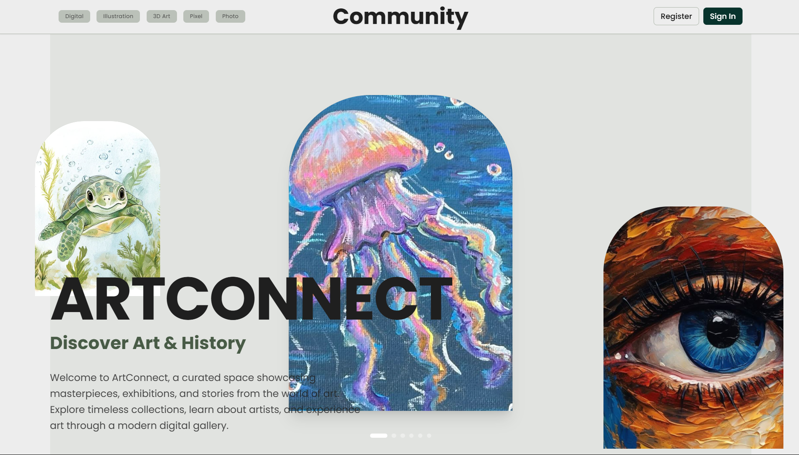

# ArtConnect Community

[](https://react.dev/)
[](https://www.typescriptlang.org/)
[](https://vite.dev/)
[](https://tailwindcss.com/)
[](https://reactrouter.com/)
[](https://tanstack.com/query)

ArtConnect Community is the frontend community module for the broader ArtConnect platform. It provides an art-focused interface for discovering community content, browsing a feed, viewing featured artwork, and signing in or registering for an account.

## Preview

<p align="center">
  
</p>

This repository represents the client-side experience of that module. It is organized as a Vite-powered React application with reusable UI components, route-level pages, application providers, design tokens, and a service layer that currently supplies mock community data.

## Features

- **Authentication flows**
  - Sign in at `/signin`
  - Register at `/register`
  - Local authentication context with user state persisted to `localStorage`
- **Community feed**
  - Paginated post loading through an infinite TanStack Query hook
  - Artwork cards with author information, descriptions, tags, dates, likes, and comments UI
  - Load-more interaction for additional feed pages
- **Featured artwork**
  - Featured visual content at `/feature`
  - Synchronized horizontal artwork views and responsive artwork collections
- **Home experience**
  - ArtConnect landing experience at `/`
  - Responsive gallery and exhibition sections
- **Shared UI**
  - Reusable avatar, button, and card components
  - Shared header, footer, and layout sections
- **Responsive styling**
  - Tailwind CSS utilities backed by ArtConnect CSS design tokens

## Technology Stack

| Technology | Role |
| --- | --- |
| React 19 | Component-based user interface |
| TypeScript 5.9 | Typed application code |
| Vite 7 | Development server and production build tooling |
| Tailwind CSS 3 | Utility-first styling |
| React Router 7 | Client-side routing |
| TanStack Query 5 | Server-state and asynchronous feed loading |
| React Icons and Lucide React | Interface icons |
| CSS variables | Shared visual design tokens |

## Routes

| Path | Page |
| --- | --- |
| `/` | Home and community landing page |
| `/feed` | Community feed |
| `/feature` | Featured artwork |
| `/signin` | Sign-in form |
| `/register` | Registration form |

## Architecture

The project uses a feature-oriented structure. Route-specific pages, hooks, components, and services live together under `src/app/routes`, while cross-feature UI and application concerns live in shared directories.

```text
src/
├── app/
│   └── routes/
│       ├── auth/                 # Sign-in and registration pages/components
│       ├── community/            # Feed, featured content, post UI, hooks, services
│       └── home/                 # Landing page sections
├── components/
│   └── common/                   # Shared Avatar, Button, and Card components
├── layout/                       # Header, footer, and reusable page sections
├── providers/                    # Authentication and TanStack Query providers
├── styles/                       # Global styles and design tokens
├── utils/                        # Shared formatting helpers
├── App.tsx                       # Router and application composition
└── main.tsx                      # React entry point and AuthProvider setup
```

### Application and data flow

```text
React UI
  ↓
React Router
  ↓
Route pages and shared components
  ↓
TanStack Query (`useInfinitePosts`)
  ↓
Community service (`communityApi`)
  ↓
In-memory mock post data
```

The current community service simulates network latency and pagination locally. It is not yet connected to a remote backend API. The application also includes a local `AuthProvider`; sign-in and registration update client-side context state and `localStorage`.

## Design System

Shared visual values are defined as CSS variables in [`src/styles/tokens.css`](src/styles/tokens.css). Tailwind color utilities extend the same palette through [`tailwind.config.js`](tailwind.config.js).

### Color tokens

| Token | Value | Purpose |
| --- | --- | --- |
| `--color-deep` | `#07332c` | Primary dark brand color |
| `--color-olive` | `#485b46` | Secondary brand color |
| `--color-soft` | `#afb7ac` | Soft surfaces and borders |
| `--color-accent` | `#bca879` | Accent and highlight color |
| `--color-bg` | `#ededed` | Application background |
| `--color-text` | `#1f1f1f` | Primary text |
| `--color-white` | `#ffffff` | White surfaces and text contrast |

The same file also centralizes typography, spacing, border radii, and shadows. Using tokens keeps repeated visual decisions consistent and makes future theme adjustments easier.

## Getting Started

### Prerequisites

- Node.js and npm

### Installation

```bash
git clone https://github.com/galhkoernia/artconnect-community.git
cd artconnect-community
npm install
```

### Development commands

```bash
# Start the Vite development server
npm run dev

# Run ESLint with zero warnings allowed
npm run lint

# Type-check and create a production build
npm run build

# Preview the production build locally
npm run preview
```

No environment variables are currently required by the application, and the repository does not include an `.env.example` file.

## Project Status

**Status: Active Development**

The frontend is being developed as part of the wider ArtConnect platform. The community feed currently uses local mock data, so remote API integration and broader platform integration remain outside the current implementation.

## Developer

**Galuh Kurnia Pratama**

- Contribution: ArtConnect Community Frontend

## License

No license file is currently included in this repository.
